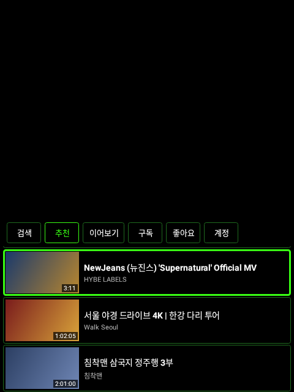
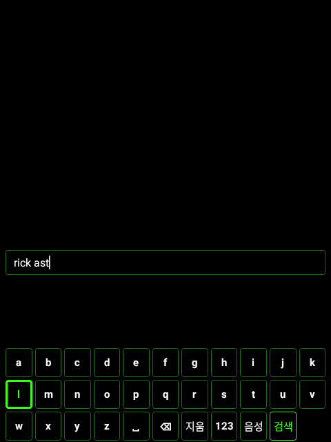
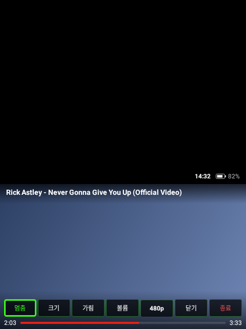
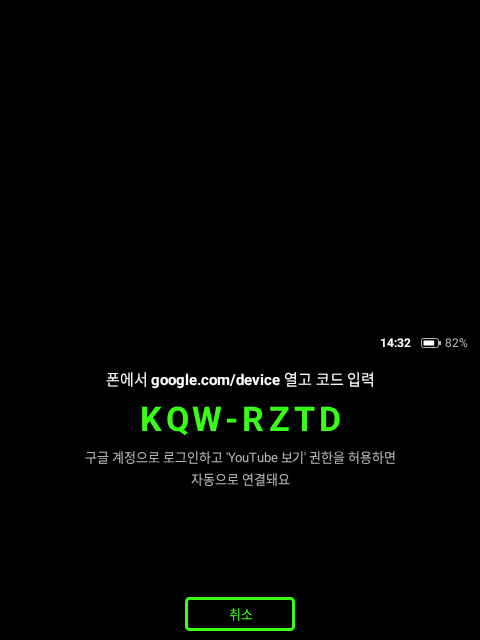

# Rokid YouTube

Rokid 안경용 유튜브 앱입니다. 화면 전체가 아래쪽 **480dp × 282dp 띠** 안에 그려지고, 띠는 바텀 마진 없이 화면 맨 아래에 붙어 있습니다. 띠 위쪽은 검은색이라 안경에서는 투명하게 보입니다.

유튜브 영상을 불러오고 재생하는 방식은 [RokidPipe](https://github.com/Anezium/RokidPipe)(NewPipe 포크)에서 그대로 가져왔고, 화면은 이 띠 크기에 맞춰 Kotlin으로 새로 만들었습니다. RokidPipe를 고친 버전은 `rokid-hud-band` 브랜치에 있습니다.

## 화면

| 홈 | 검색 키보드 | 플레이어 | 구글 로그인 |
|---|---|---|---|
|  |  |  |  |

위 그림은 [Paparazzi](https://github.com/cashapp/paparazzi)가 실제 레이아웃 코드로 그린 480×640 화면입니다. 썸네일과 영상 화면은 그림 대신 색만 넣었습니다.

## 홈 탭

카테고리 대신 개인 피드입니다. 영상은 위아래로 넘기는 세로 목록이고, 한 줄에 카드 하나씩 한 화면에 3개가 보입니다.

| 탭 | 내용 | 로그인 |
|---|---|---|
| 검색 | 안경용 키보드(영어·숫자), 한국어는 **음성** 키 | 필요 없음 |
| 추천 | 좋아요한 영상의 관련 영상 + 구독 채널 새 영상 + 이 안경에서 본 영상의 관련 영상을 섞어서 보여 줌. 아무것도 없으면 인기 영상 | 없어도 됨 (하면 더 정확) |
| 이어보기 | 보다 만 영상. 누르면 멈춘 곳부터 재생 | 필요 없음 |
| 구독 | 구독 채널의 최신 영상 | 필요 |
| 좋아요 | 좋아요한 영상 | 필요 |
| 로그인 / 계정 | 구글 계정 연결, 로그아웃, 시청 기록 지우기 | |

**추천은 유튜브 알고리즘 그 자체가 아닙니다.** 공식 API에는 "나를 위한 추천" 기능이 없습니다(유튜브 앱 내부 API는 구글 TV 앱을 사칭해야 해서 쓰지 않습니다). 대신 로그인하면 **좋아요한 영상 최근 8개의 관련 영상**과 **구독 채널의 새 영상**을 재료로 써서, 처음부터 내 취향에 맞춰 나옵니다. 여기에 이 안경에서 본 영상의 관련 영상이 더해지고, 이미 본 영상과 좋아요한 영상은 빠집니다. 계정 쪽 재료는 30분 동안 저장해 두고 다시 씁니다(API 사용량은 한 번에 2~5 단위). 시청 기록은 안경 안에만 저장됩니다.

## 조작

| 동작 | 목록·키보드 | 플레이어 (버튼 숨김) | 플레이어 (버튼 보임) |
|---|---|---|---|
| 앞/뒤로 쓸기 | 다음/이전 항목 | 10초 앞/뒤로 | 다음/이전 버튼 |
| 위/아래로 쓸기 | 이전/다음 항목 | 영상 크기 10% 키우기/줄이기 (20%~100%) | 영상 크기 10% 키우기/줄이기 |
| 탭 | 선택 | 버튼 보이기 | 버튼 누르기 |
| 뒤로 | 이전 화면 | 플레이어 닫기 | 버튼 숨기기 |

- **안경 터치패드:** RokidPipe와 같은 키 매핑입니다. 쓸기는 DPAD 좌우·183/184, 탭은 ENTER·202이고, 한 번 쓸기에 두 번 들어오는 이벤트는 240ms 디바운스로 거릅니다.
- **R08 링 ([R08 Access Bridge](https://github.com/Anezium/R08-Access-Bridge)):** 링 앞/뒤는 다음/이전, 탭은 선택, 더블탭은 뒤로입니다. 브리지는 전용 연동이 없는 앱을 접근성 기능으로 조작합니다. 그래서 이 앱은 링 전용 노드(`RingTarget`) 하나만 노출해서, 브리지가 보내는 스크롤과 클릭을 위 동작으로 바꿉니다. 브리지가 꺼져 있을 때 들어오는 링 미디어 키도 같은 동작입니다.

## 구글 로그인 설정 (구독·좋아요 탭용)

Herald처럼 **구글 공식 로그인**(OAuth 기기 코드 방식)과 **YouTube Data API**(읽기 전용)를 씁니다. 키는 직접 만든 걸 써야 하고, 무료입니다.

1. [Google Cloud Console](https://console.cloud.google.com/)에서 새 프로젝트를 만듭니다.
2. **API 및 서비스 → 라이브러리**에서 **YouTube Data API v3**를 찾아 **사용**을 누릅니다.
3. **Google 인증 플랫폼(OAuth 동의 화면)**을 설정합니다.
   - 사용자 유형은 **외부**, 앱 이름과 이메일은 아무거나 넣으면 됩니다.
   - **대상(Audience)**에서 **앱 게시(프로덕션)**를 누릅니다. "테스트" 상태로 두면 7일마다 다시 로그인해야 합니다.
   - 프로덕션으로 바꾸면 처음 로그인할 때 "Google에서 확인하지 않은 앱" 경고가 뜹니다. **고급 → (앱 이름)(으)로 이동**을 누르면 됩니다. 본인이 만든 앱이라 괜찮습니다.
4. **사용자 인증 정보 → 사용자 인증 정보 만들기 → OAuth 클라이언트 ID**에서 애플리케이션 유형을 **TV 및 입력이 제한된 기기**로 고릅니다.
5. 나온 클라이언트 ID와 보안 비밀을 `local.properties`에 넣습니다. 이 파일은 git에 올라가지 않습니다.
   ```properties
   googleClientId=1234567890-xxxx.apps.googleusercontent.com
   googleClientSecret=GOCSPX-xxxx
   ```
   환경 변수 `GOOGLE_CLIENT_ID` / `GOOGLE_CLIENT_SECRET`로 넣어도 됩니다(클라우드 빌드 환경용).
6. 다시 빌드해서 설치합니다. 안경 홈 오른쪽 끝 **[로그인]**을 누르고, 폰에서 google.com/device를 열어 안경에 뜬 코드를 입력합니다.

**하루 사용량 한도:** YouTube Data API는 프로젝트당 하루 10,000 단위입니다. 구독 목록이나 좋아요를 한 번 불러오는 데 1~4 단위라 개인용으로는 충분합니다. 구독 채널의 새 영상 자체는 채널 공개 피드(RSS)에서 받아서 한도를 쓰지 않습니다. 한도를 넘으면 태평양 시간 자정에 초기화됩니다.

## RokidPipe에서 가져온 것

| 이 프로젝트 | RokidPipe 원본 |
|---|---|
| `net/OkHttpDownloader.kt` | `DownloaderImpl.java` |
| `potoken/*` (유튜브 봇 확인 토큰, WebView) | `util/potoken/*` |
| `player/YoutubeHttpDataSource.java` | `player/datasource/YoutubeHttpDataSource.java` |
| `player/YoutubeMediaSources.kt` | `player/resolver/PlaybackResolver.java`, `player/helper/PlayerDataSource.java` |
| `player/StreamSelector.kt` | `util/ListHelper.java`, `player/resolver/VideoPlaybackResolver.java` |
| `ui/GlassesInput.kt` | `rokid/RokidKeyMapper.java` |

라이브러리: NewPipeExtractor v0.26.3, ExoPlayer 2.19.1 (RokidPipe와 같은 버전).

## 빌드와 설치

```bash
./gradlew :app:assembleDebug
adb install -r app/build/outputs/apk/debug/app-debug.apk
```

## 테스트

```bash
./gradlew :app:testDebugUnitTest          # 입력 매핑, 화질 선택, 시청 기록·추천, 로그인 응답 파싱, R08 링
./gradlew :app:recordPaparazziDebug       # 화면 스냅샷 → app/src/test/snapshots/images
./gradlew :app:testDebugUnitTest -PnetworkTests=true --tests '*YouTubeNetworkTest*'  # 실제 유튜브 접속
```

## 확인한 것과 안 한 것

- **확인함:** 실제 유튜브를 상대로 검색, 인기 영상, 관련 영상(추천 재료), 채널 새 영상 피드(구독 탭 재료), 재생할 스트림 고르기. 구글 기기 코드 서버 응답.
- **안경에서 확인해야 함:** 실제 재생, 터치패드와 R08 링 조작, 음성 인식, 구글 로그인과 구독·좋아요 탭(본인 계정과 키 필요), 글자 가독성.
- PoToken은 안경의 WebView에서 만들어집니다. 안경 WebView가 오래되었으면 재생이 막힐 수 있습니다.

## 라이선스

GPL-3.0. NewPipeExtractor와 RokidPipe/NewPipe 코드가 GPL-3.0이기 때문입니다. `YoutubeHttpDataSource`는 ExoPlayer(Apache 2.0) 코드를 기반으로 합니다.
